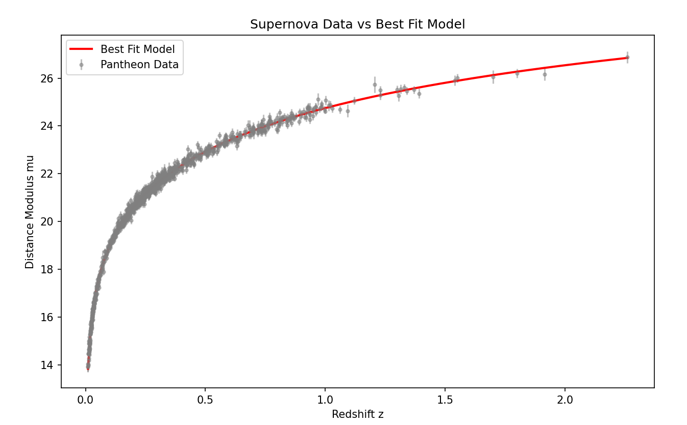
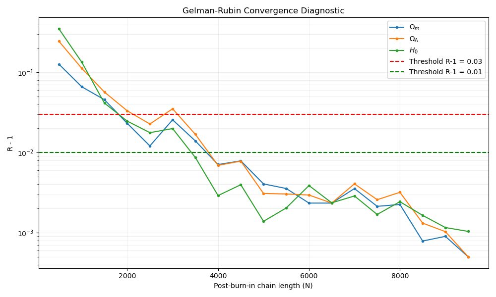

# Numerical Cosmology — Visual Portfolio

> **Coursework publication notice / 课程作业展示说明**
>
> To respect course academic-integrity requirements, detailed numerical result tables and written summaries, assignment solution code, mathematical derivations, and original written answers are kept private. This public portfolio presents visual outputs, project context, and skills only.
>
> **为遵循课程对作业解答的发布限制，具体数值的表格与文字汇总、作业解答代码、推导及原始书面答案均保留在私有仓库。公开部分仅展示图表、项目概述与技能。**
>
> Original axes and annotations within the figures are retained. 图中的原有坐标刻度与数值标注保留。

**Qingyang Ling · University of Edinburgh Computer Modelling**

A coursework-based visual portfolio in scientific programming and cosmological data analysis. The work covers numerical integration, distance models, likelihood fitting, parameter-space exploration, Markov chain Monte Carlo, and convergence diagnostics.

## Selected visuals

## Explore the galleries

| Topic | Figures |
| --- | --- |
| [Distances and numerical methods](galleries/unit03/README.md) | Integration convergence, comoving distance, distance modulus, and parameter sensitivity |
| [Likelihood fitting](galleries/unit04/README.md) | Numerical resolution, model fit, and normalized residuals |
| [Parameter inference](galleries/unit05/README.md) | Grid marginals, sampling trace, and posterior visualizations |
| [Convergence diagnostics](galleries/unit06/README.md) | Independent-chain diagnostic plot |

## Skills and interpretation

Python, NumPy, SciPy, Matplotlib, numerical accuracy checks, scientific data analysis, statistical inference, and documenting model assumptions.

The figures preserve historical coursework outputs; they were not regenerated for this gallery. The inference experiment uses a simplified supernova magnitude model with diagonal measurement errors and a fixed absolute-magnitude assumption. Its parameter constraints depend on those modeling choices.

This public repository contains original figures and a broad project overview. Assessed code, mathematical derivations, original reports, numerical result tables, and the supplied dataset remain in a separate private coursework archive. Original coordinates and numerical annotations within the plots are retained; the images are not redacted.

[Display scope and provenance](DISPLAY.md)

中文简介：科学计算与宇宙学分析的可视化作品展示。完整解答代码、原始报告、推导及数值表保留私有；公开页面只展示图表、项目概述和技能。
