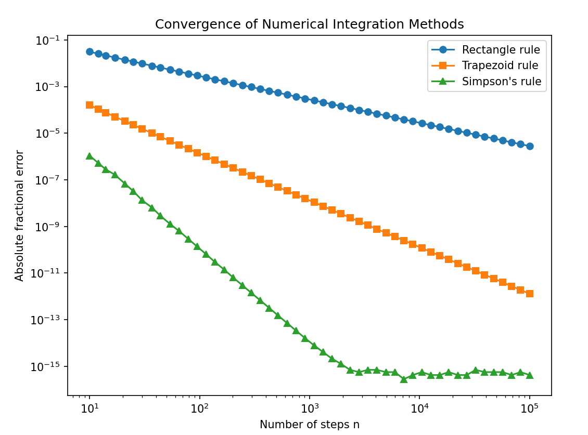
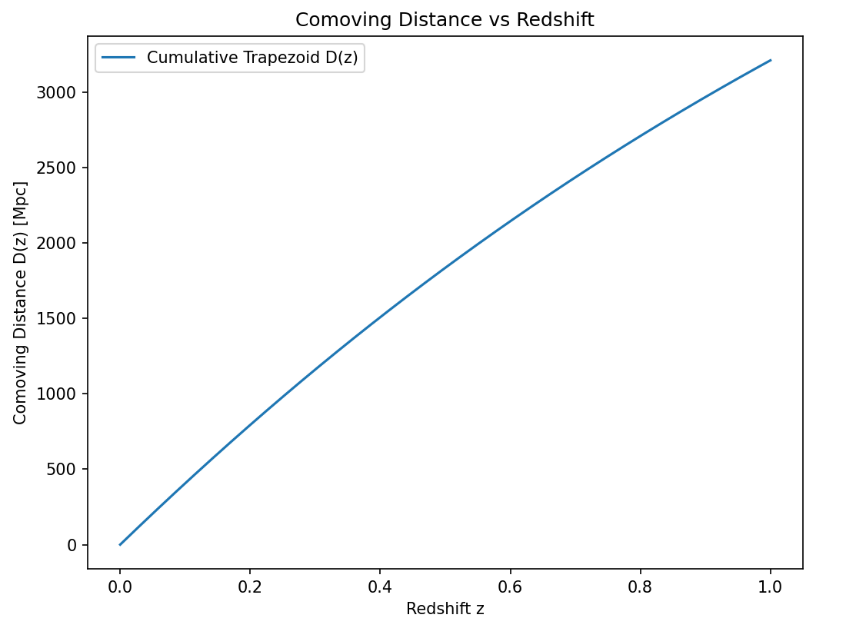
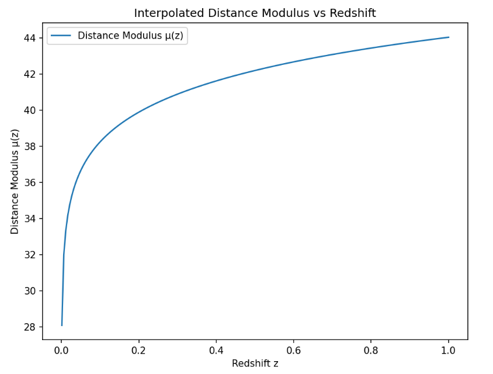
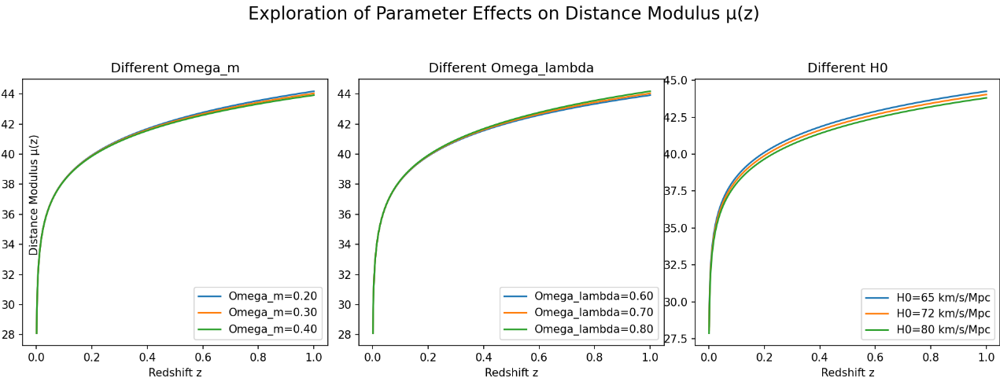

# Distances and numerical methods

> **Coursework display:** numerical result tables, solution code, and derivations are kept private to respect course academic-integrity requirements. [Publication notice](../../README.md).

Original saved coursework figures. Submitted methods, implementation details, numerical answer tables, and written reports are retained privately.

## Numerical integration convergence

## Comoving distance

## Distance modulus

## Parameter sensitivity

[Portfolio overview](../../README.md)
