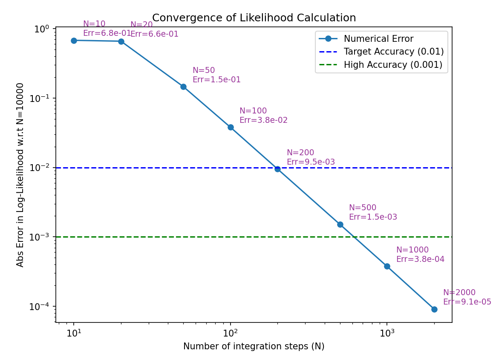
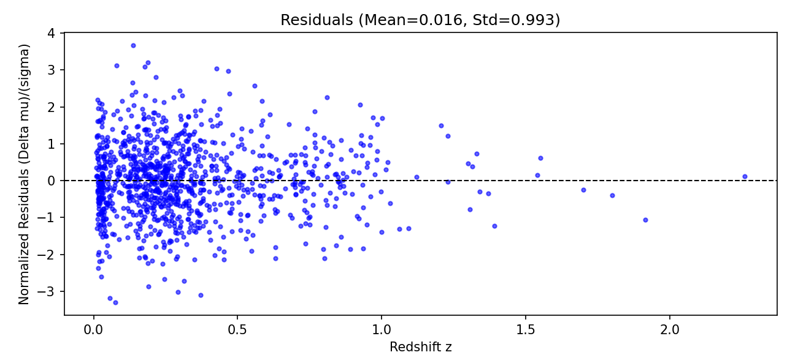

# Likelihood fitting

> **Coursework display:** numerical result tables, solution code, and derivations are kept private to respect course academic-integrity requirements. [Publication notice](../../README.md).

Original saved coursework figures. Submitted methods, implementation details, numerical answer tables, and written reports are retained privately.

## Likelihood resolution

## Supernova model fit

The original axis label says distance modulus, while the plotted fit compares observed and modeled apparent magnitudes. The image is preserved unchanged.

## Normalized residuals

[Portfolio overview](../../README.md)
