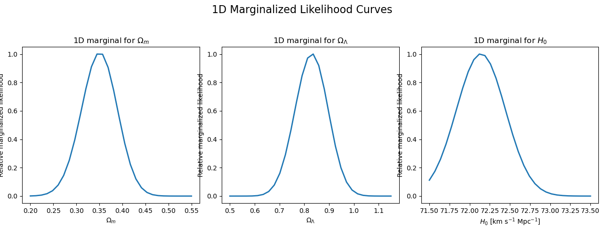
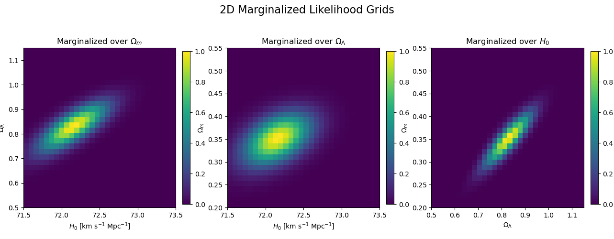
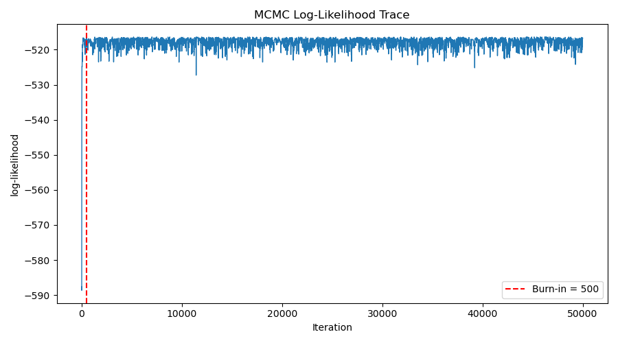
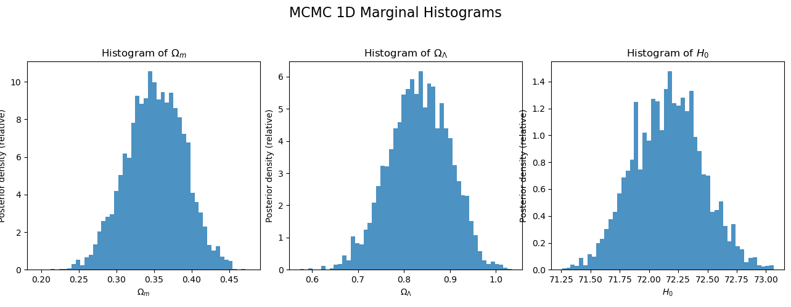
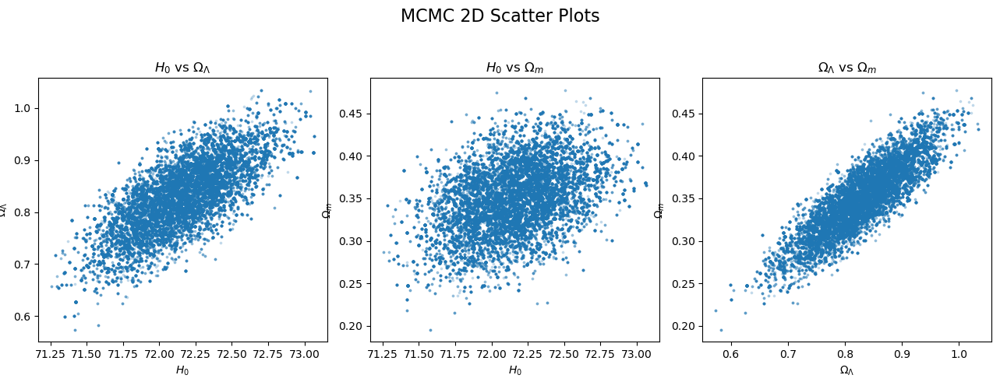

# Parameter-space exploration and MCMC

> **Coursework display:** numerical result tables, solution code, and derivations are kept private to respect course academic-integrity requirements. [Publication notice](../../README.md).

Original saved coursework figures. Submitted methods, implementation details, numerical answer tables, and written reports are retained privately.

## Grid marginals

## Grid parameter relationships

## Sampling trace

## Posterior marginals

## Posterior parameter relationships

[Portfolio overview](../../README.md)
